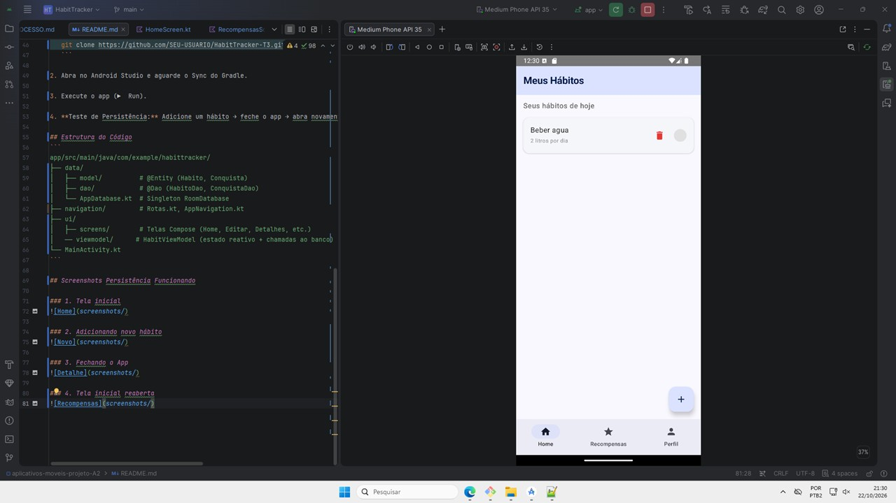
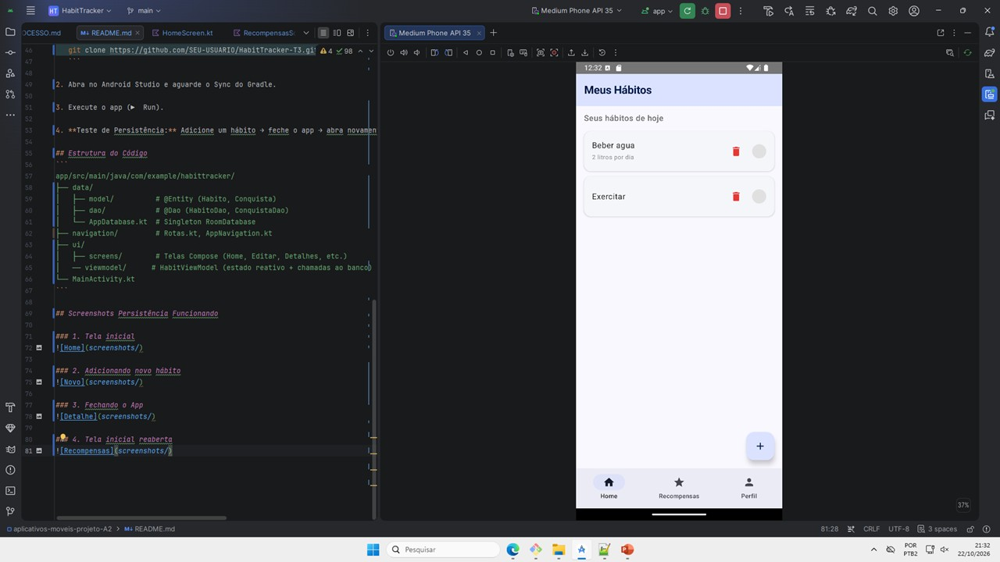
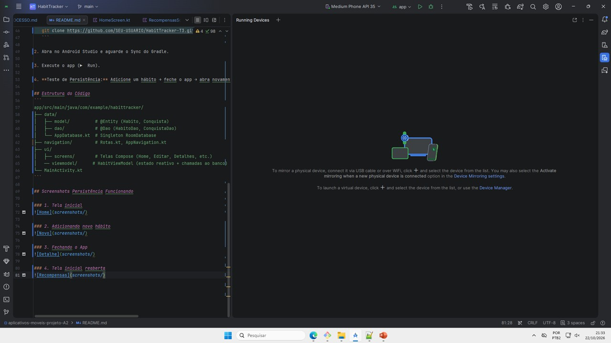
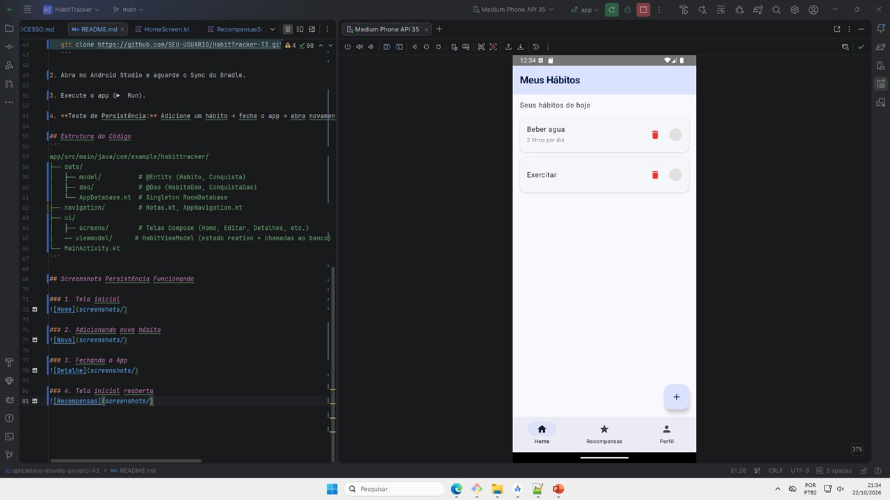

# HabitTracker - Trabalho 3 (Persistência com Room)

Aplicativo Android individual de rastreamento de hábitos diários, evoluído para suportar persistência de dados local via Room (SQLite).

## Integrante
- Marcio Henrique

## Funcionalidades Implementadas
### CRUD Completo de Hábitos
- ✅ Criar novo hábito (nome, descrição, dias da semana)
- ✅ Listar hábitos do banco (LazyColumn)
- ✅ Editar hábito existente (tela separada)
- ✅ Deletar hábito (botão lixeira)
- ✅ Marcar/desmarcar conclusão (persistido)

### CRUD Completo de Conquistas
- ✅ Criar nova conquista (título, descrição)
- ✅ Listar conquistas do banco (LazyColumn)
- ✅ Editar conquista existente (tela separada)
- ✅ Deletar conquista (botão lixeira)
- ✅ Marcar/desmarcar desbloqueio (persistido)

### Navegação e Detalhes
- ✅ BottomNavigationBar com 3 abas principais
- ✅ Tela de detalhes do hábito busca dados direto do banco pelo ID
- ✅ Complexidade extra: taxa de conclusão calculada + barra de progresso visual
- ✅ Botão voltar funcional em todas as telas secundárias

## Tecnologias
- Kotlin + Jetpack Compose (Material 3)
- Navigation Compose
- Room (SQLite) + KSP
- ViewModel + Coroutines (Dispatchers.IO)
- Android Studio

## Como Rodar o Projeto

### Pré-requisitos
- Android Studio Hedgehog ou superior
- JDK 17 (configurado no Gradle Settings)
- Emulador API 24+ ou dispositivo físico

### Passo a Passo
1. Clone o repositório:
   ```bash
   git clone https://github.com/mhenriqueof/aplicativos-moveis-projeto-A2.git
   ```

2. Abra no Android Studio e aguarde o Sync do Gradle.

3. Execute o app (▶️ Run).

4. **Teste de Persistência:** Adicione um hábito → feche o app → abra novamente → verifique se o hábito continua lá.

## Estrutura do Código
```
app/src/main/java/com/example/habittracker/
├── data/
│   ├── model/          # @Entity (Habito, Conquista)
│   ├── dao/            # @Dao (HabitoDao, ConquistaDao)
│   └── AppDatabase.kt  # Singleton RoomDatabase
├── navigation/         # Rotas.kt, AppNavigation.kt
├── ui/
│   ├── screens/        # Telas Compose (Home, Editar, Detalhes, etc.)
│   ── viewmodel/      # HabitViewModel (estado reativo + chamadas ao banco)
└── MainActivity.kt
```

## Screenshots Persistência Funcionando

### 1. Tela inicial


### 2. Adicionando novo hábito


### 3. Fechando o App


### 4. Tela inicial reaberta
